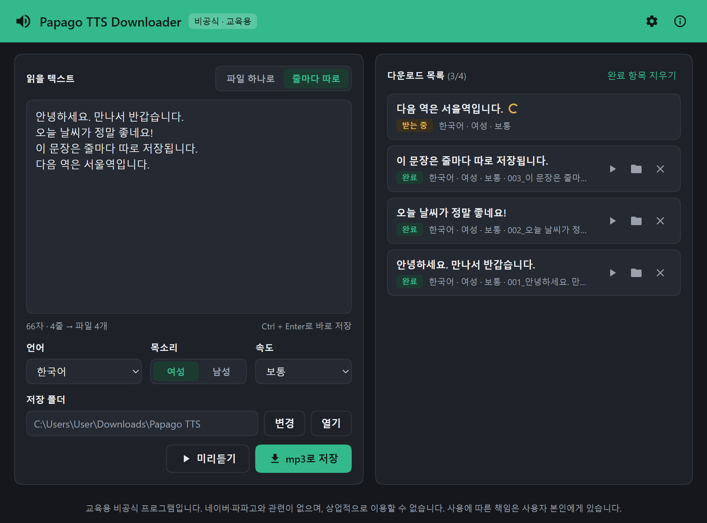
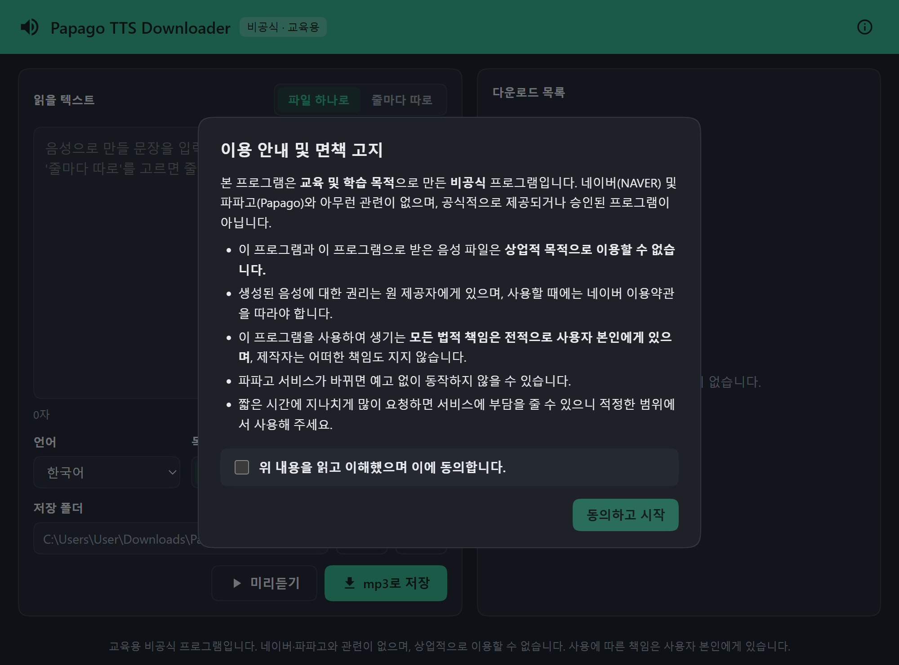

# Papago TTS Downloader (비공식 · 교육용)

파파고 번역기의 "듣기" 음성을 mp3 파일로 저장하는 가벼운 데스크톱 프로그램입니다.
Rust + [Tauri 2](https://tauri.app)로 만들었습니다. (설치 파일 약 1.4MB, 실행 파일 약 3.8MB)



> ## ⚠️ 이용 안내 및 면책 고지
>
> 본 프로그램은 **교육 및 학습 목적**으로 만든 **비공식** 프로그램입니다.
> 네이버(NAVER) 및 파파고(Papago)와 아무런 관련이 없으며, 공식적으로 제공되거나 승인된 프로그램이 아닙니다.
>
> - 이 프로그램과 이 프로그램으로 받은 음성 파일은 **상업적 목적으로 이용할 수 없습니다.**
> - 생성된 음성에 대한 권리는 원 제공자에게 있으며, 사용할 때에는 네이버 이용약관을 따라야 합니다.
> - 이 프로그램을 사용하여 생기는 **모든 법적 책임은 전적으로 사용자 본인에게 있으며**, 제작자는 어떠한 책임도 지지 않습니다.
> - 파파고 서비스가 바뀌면 예고 없이 동작하지 않을 수 있습니다.
> - 짧은 시간에 지나치게 많이 요청하면 서비스에 부담을 줄 수 있으니 적정한 범위에서 사용해 주세요.
>
> 프로그램을 처음 실행하면 같은 내용이 표시되며, 동의해야 사용할 수 있습니다.
>
> 📮 **문의 및 신고**: 이 프로그램이나 저장소에 저작권 등 문제가 되는 부분이 있다면 **yuchxn0@gmail.com** 으로 연락 주세요. 확인 후 바로 조치하겠습니다.

## 다운로드

[Releases](../../releases/latest) 페이지에서 받을 수 있습니다 (Windows 10/11, 64비트).

- `Papago.TTS.Downloader_x.y.z_x64-setup.exe`: 설치 파일
- `papago-tts-downloader.exe`: 설치 없이 바로 실행하는 파일

> 서명되지 않은 프로그램이라 처음 실행할 때 Windows SmartScreen 경고가 뜰 수 있습니다. "추가 정보" → "실행"을 누르면 됩니다.

## 스크린샷

| 라이트 테마 | 처음 실행 시 이용 안내 |
|---|---|
|  |  |

## 기능

- 10개 언어 (한국어, 영어, 일본어, 중국어 간체·번체, 스페인어, 프랑스어, 독일어, 러시아어, 태국어)
- 여성/남성 목소리, 속도 4단계 (아주 느리게 · 느리게 · 보통 · 빠르게)
- 미리듣기
- **파일 하나로**: 입력한 글 전체를 mp3 하나로 저장. 1000자가 넘는 글은 문장 단위로 나눠 받은 뒤 하나로 이어 붙입니다 (최대 20,000자).
- **줄마다 따로**: 줄마다 `001_문장.mp3`처럼 파일을 하나씩 저장 (최대 300줄)
- 다운로드 목록: 진행 상태, 재생, 폴더에서 보기, 실패 항목 다시 시도
- 같은 이름의 파일이 있으면 덮어쓰지 않고 `이름 (2).mp3`로 저장
- 설정(언어·목소리·속도·저장 폴더) 기억, 다크 모드 지원

## 동작 원리

파파고 웹페이지가 내부에서 쓰는 요청을 그대로 보냅니다.

1. `POST https://papago.naver.com/api/tts/makeID`
   폼 데이터: `alpha=0`, `pitch=0`, `speaker=<화자>`, `speed=<속도>`, `text=<문장>` → `{"id": "..."}`
2. `GET https://papago.naver.com/api/tts/{id}` → `audio/mpeg` (24kHz, 64kbps, 모노)

화자 표와 속도 값은 파파고 웹 코드의 것과 같습니다 ([src-tauri/src/tts.rs](src-tauri/src/tts.rs)).
비공식 엔드포인트라 파파고가 사이트를 바꾸면 이 부분을 고쳐야 할 수 있습니다.

## 빌드하기 (Windows)

필요한 것:

- [Rust](https://rustup.rs) (MSVC 툴체인)
- Visual Studio Build Tools의 "C++를 사용한 데스크톱 개발"
- Node.js (Tauri CLI용)
- WebView2 (Windows 10/11에는 기본 설치되어 있음)

```powershell
npm install
npm run dev      # 개발 모드로 실행
npm run build    # 배포용 빌드
```

빌드 결과:

- 실행 파일: `src-tauri/target/release/papago-tts-downloader.exe`
- 설치 파일: `src-tauri/target/release/bundle/nsis/`

## 폴더 구조

```
ui/                  화면 (HTML/CSS/JS, 번들러 없음)
src-tauri/src/tts.rs 파파고 요청, 긴 글 나누기, mp3 이어 붙이기
src-tauri/src/main.rs Tauri 명령 (미리듣기, 저장, 탐색기 열기)
docs/                README용 스크린샷
```

## 문의

문제가 되는 부분이 있거나 궁금한 점이 있다면 **yuchxn0@gmail.com** 으로 연락 주세요.
